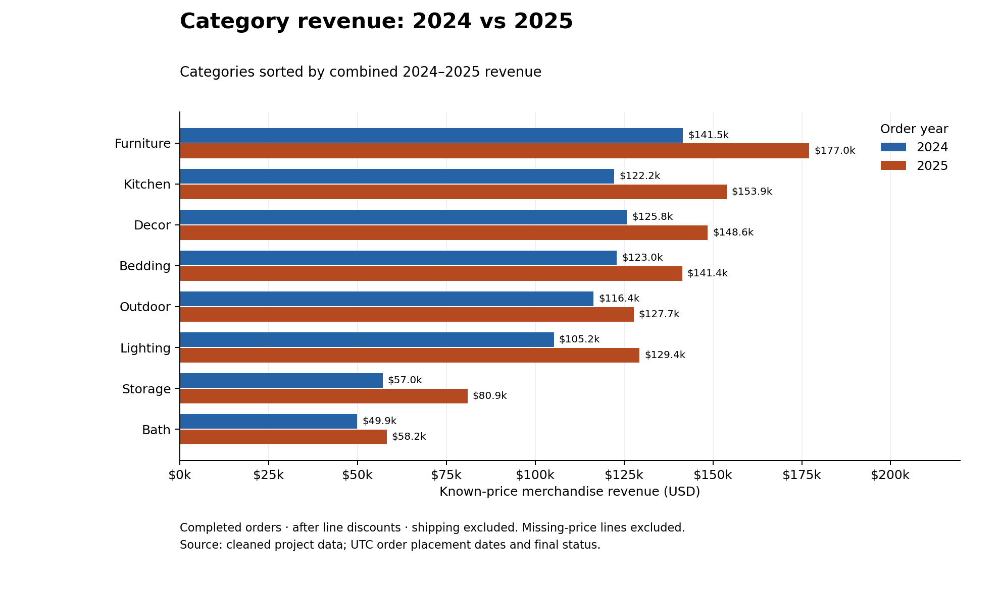
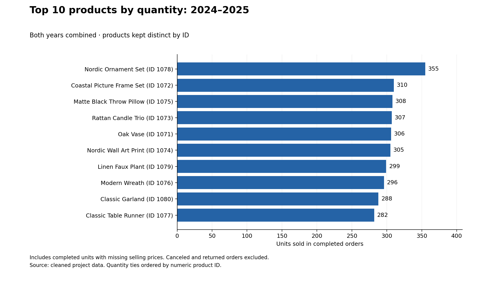
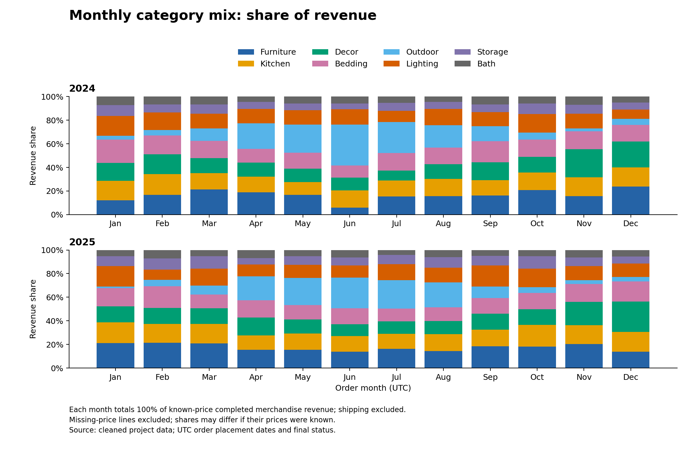

# Category and product analysis: 2024–2025

## Definitions and scope

Uses [the agreed revenue definition](metrics.md): known-price lines from completed orders, quantity × historical unit price − line discount, excluding shipping. No prices are estimated. Revenue is calculated in integer cents and grouped by UTC order placement date and final status. Canceled and returned orders are excluded. Products and categories are joined by product ID.

Category share = category known-price revenue ÷ total known-price revenue for the same period. Monthly shares use each month’s total; annual shares use each year’s total. Missing prices may affect the revenue ranking and mix. Line coverage is record coverage, not the percentage of dollar revenue captured. Product quantities include completed units even when their selling price is missing. Rankings use product ID to keep names distinct; ties are ordered by numeric product ID, with exactly ten products shown.

## Observations

- Furniture generated the most combined known-price revenue: $318,593.13 (17.15% of 2024–2025 revenue).
- Nordic Ornament Set (ID 1078) ranked first by completed quantity: 355 units.
- Outdoor had the largest absolute annual revenue-share change: 13.84% in 2024 to 12.56% in 2025 (-1.28 percentage points).
- Outdoor reached its highest monthly revenue share in June 2024 (34.56%) and June 2025 (26.15%). These are composition peaks, not necessarily peak dollar sales.
- Decor reached its highest monthly revenue share in November 2024 (23.84%) and December 2025 (25.87%). These are composition peaks, not necessarily peak dollar sales.

## Category revenue by year

| Category | 2024 revenue | 2024 share | 2025 revenue | 2025 share | YoY revenue | Share change (pp) |
|---|---:|---:|---:|---:|---:|---:|---:|
| Furniture | $141,549.39 | 16.83% | $177,043.74 | 17.41% | +25.08% | +0.58 |
| Kitchen | $122,232.49 | 14.53% | $153,870.57 | 15.13% | +25.88% | +0.60 |
| Decor | $125,814.80 | 14.96% | $148,552.69 | 14.61% | +18.07% | -0.35 |
| Bedding | $122,968.88 | 14.62% | $141,352.38 | 13.90% | +14.95% | -0.72 |
| Outdoor | $116,412.15 | 13.84% | $127,685.15 | 12.56% | +9.68% | -1.28 |
| Lighting | $105,226.04 | 12.51% | $129,357.03 | 12.72% | +22.93% | +0.21 |
| Storage | $57,047.99 | 6.78% | $80,930.02 | 7.96% | +41.86% | +1.18 |
| Bath | $49,884.59 | 5.93% | $58,193.09 | 5.72% | +16.66% | -0.21 |

### Category price coverage

| Year | Category | Completed lines | Missing-price lines | Missing-price units | Line coverage |
|---|---|---:|---:|---:|---:|
| 2024 | Bath | 751 | 7 | 9 | 99.07% |
| 2024 | Bedding | 851 | 8 | 12 | 99.06% |
| 2024 | Decor | 1,311 | 14 | 18 | 98.93% |
| 2024 | Furniture | 411 | 5 | 5 | 98.78% |
| 2024 | Kitchen | 1,330 | 16 | 19 | 98.80% |
| 2024 | Lighting | 546 | 6 | 9 | 98.90% |
| 2024 | Outdoor | 642 | 4 | 5 | 99.38% |
| 2024 | Storage | 761 | 11 | 16 | 98.55% |
| 2025 | Bath | 837 | 8 | 9 | 99.04% |
| 2025 | Bedding | 921 | 11 | 15 | 98.81% |
| 2025 | Decor | 1,510 | 20 | 30 | 98.68% |
| 2025 | Furniture | 480 | 5 | 5 | 98.96% |
| 2025 | Kitchen | 1,607 | 22 | 29 | 98.63% |
| 2025 | Lighting | 662 | 11 | 15 | 98.34% |
| 2025 | Outdoor | 709 | 15 | 20 | 97.88% |
| 2025 | Storage | 954 | 13 | 14 | 98.64% |

## Top 10 products by completed quantity

| Rank | Product ID | Product | Category | Units |
|---:|---|---|---|---:|
| 1 | 1078 | Nordic Ornament Set | Decor | 355 |
| 2 | 1072 | Coastal Picture Frame Set | Decor | 310 |
| 3 | 1075 | Matte Black Throw Pillow | Decor | 308 |
| 4 | 1073 | Rattan Candle Trio | Decor | 307 |
| 5 | 1071 | Oak Vase | Decor | 306 |
| 6 | 1074 | Nordic Wall Art Print | Decor | 305 |
| 7 | 1079 | Linen Faux Plant | Decor | 299 |
| 8 | 1076 | Modern Wreath | Decor | 296 |
| 9 | 1080 | Classic Garland | Decor | 288 |
| 10 | 1077 | Classic Table Runner | Decor | 282 |

## Monthly category revenue mix

Both panels use January–December, the same category colors and stack order, and a 0–100% scale. Each bar describes composition; see [monthly revenue](monthly_revenue.md) for total dollar changes. These are revenue shares, not quantity shares. A share change alone does not establish a change in customer preferences or its cause.

| Category | 2024 lowest / highest monthly share | 2025 lowest / highest monthly share |
|---|---|---|
| Furniture | Jun 5.93% / Dec 23.88% | Jun 13.77% / Feb 21.45% |
| Kitchen | May 10.81% / Feb 17.53% | Apr 12.38% / Oct 18.36% |
| Decor | Jul 8.62% / Nov 23.84% | Jun 10.04% / Dec 25.87% |
| Bedding | Jun 10.41% / Jan 19.92% | Jul 10.95% / Feb 18.42% |
| Outdoor | Nov 2.64% / Jun 34.56% | Jan 1.52% / Jun 26.15% |
| Lighting | Dec 7.90% / Jan 16.73% | Feb 8.75% / Sep 17.81% |
| Storage | Jun 4.94% / Jan 9.21% | Apr 5.29% / Mar 10.79% |
| Bath | Apr 4.51% / Jan 7.31% | Jul 4.18% / Feb 7.24% |

## Reproduction and validation

Run `.\.venv\Scripts\python.exe scripts\analyze_categories.py` after points 1–3. Section 4 of the notebook runs the same script and displays its outputs.

Passed: cleaned hashes and baseline metrics; joins preserve item rows; category, product, annual and all 24 monthly revenues, units and missing-price counts reconcile; category totals reconcile across views; monthly shares sum to 100%.

Aggregate exports: category_revenue_annual.csv, category_revenue_overall.csv, monthly_category_mix.csv, product_rankings.csv and category_results.json. Shares/coverage in CSV and JSON are fractions (0.10 means 10%). Missing-only revenue remains unknown; an absent category/month receives zero revenue and units and undefined line coverage. Detailed records stay under ignored data/.
