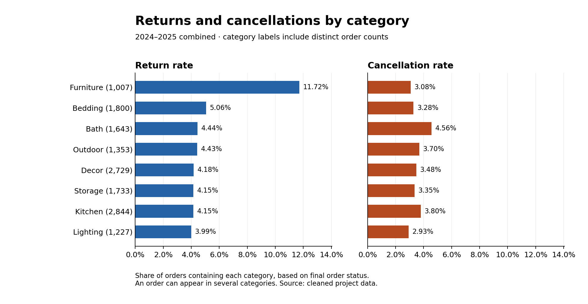

# Category order outcomes, 2024–2025

Return and cancellation rates divide the respective final-status counts by all distinct orders containing the category. Each order counts once per category. An order that contains several categories contributes its final status to each one. The data records status at order level, so the figures describe orders containing a category.

Category average order value (AOV) divides the category’s known-price merchandise revenue from completed orders by all completed orders containing that category, including orders with missing prices. Only revenue from the category’s own lines contributes to this measure. Shipping is excluded. Missing prices can pull AOV down. Price coverage is the share of completed category lines with a known unit price. The storewide AOV in metrics.md uses fully priced completed orders and measures whole baskets.

## Observations

- Furniture had the highest return rate at 11.72% (118 of 1,007 orders).
- Bath had the highest cancellation rate at 4.56% (75 of 1,643 orders).
- Furniture had the highest category AOV at $371.32.

## Category detail

| Category | All orders | Completed | Returned | Return rate | Canceled | Cancellation rate | Category AOV (USD) | Line price coverage |
|---|---:|---:|---:|---:|---:|---:|---:|---:|
| Furniture | 1,007 | 858 | 118 | 11.72% | 31 | 3.08% | $371.32 | 98.88% |
| Bedding | 1,800 | 1,650 | 91 | 5.06% | 59 | 3.28% | $160.19 | 98.93% |
| Bath | 1,643 | 1,495 | 73 | 4.44% | 75 | 4.56% | $72.29 | 99.06% |
| Outdoor | 1,353 | 1,243 | 60 | 4.43% | 50 | 3.70% | $196.38 | 98.59% |
| Decor | 2,729 | 2,520 | 114 | 4.18% | 95 | 3.48% | $108.88 | 98.79% |
| Storage | 1,733 | 1,603 | 72 | 4.15% | 58 | 3.35% | $86.07 | 98.60% |
| Kitchen | 2,844 | 2,618 | 118 | 4.15% | 108 | 3.80% | $105.46 | 98.71% |
| Lighting | 1,227 | 1,142 | 49 | 3.99% | 36 | 2.93% | $205.41 | 98.59% |

## Reproduction and validation

Run section 5 of the notebook or `.\.venv\Scripts\python.exe scripts\analyze_category_outcomes.py` after regenerating the point 4 results. Rates and line price coverage in the companion CSV are fractions. AOV uses integer-cent revenue and is rounded half up to two decimal places.

Validation checked the cleaned input hashes, join cardinality, distinct storewide counts by status and the revenue and line coverage counts for every category against point 4.
