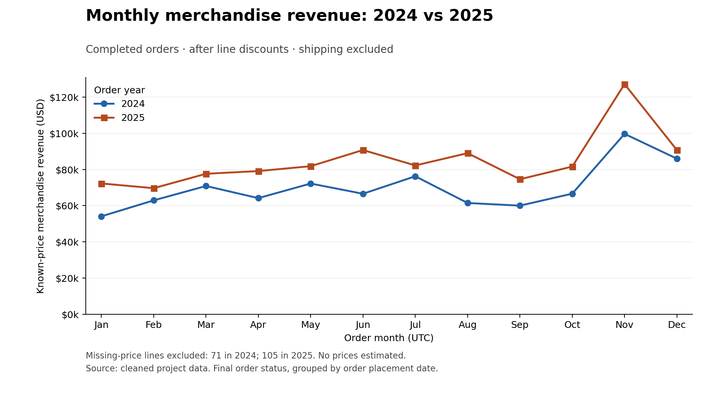

# Monthly revenue comparison: 2024 and 2025

## Scope and date coverage

Uses the definitions in [metrics.md](metrics.md). Revenue includes known-price completed lines; AOV uses only completed orders with every line priced. Shipping is separate. Missing prices are not estimated. All periods use UTC order dates and final recorded status.

All 24 expected months are present. First order: 2024-01-01T09:24:45+00:00; last order: 2025-12-31T23:23:29+00:00. There are 0 calendar days without recorded orders. See monthly_date_coverage.csv for month boundaries and observed day counts. Recorded transactions across the period do not independently prove the source extract is complete. February has 29 days in 2024 and 28 in 2025; comparisons use calendar-month totals, not daily averages.

## Observations

- Known-price merchandise revenue increased 20.91% from 2024 to 2025. 2025 revenue exceeded the matching 2024 month in 12 of 12 months.
- The two highest revenue months in 2024 were November ($99,725.00), December ($86,011.90).
- The two highest revenue months in 2025 were November ($127,233.13), June ($90,781.42).
- Completed-line price coverage ranged from 97.81% (2025-11) to 99.78% (2024-09). These are record coverage rates, not percentages of revenue captured; unknown selling prices could affect the comparisons.
- Both years place November among their two highest revenue months. This suggests a recurring peak, but two years cannot establish a stable seasonal pattern or its cause.

## Revenue comparison

| Month | 2024 revenue | 2025 revenue | Change (USD) | YoY |
|---|---:|---:|---:|---:|
| Jan | $54,107.56 | $72,297.91 | $+18,190.35 | +33.62% |
| Feb | $62,945.69 | $69,676.90 | $+6,731.21 | +10.69% |
| Mar | $70,885.83 | $77,653.21 | $+6,767.38 | +9.55% |
| Apr | $64,177.27 | $79,149.13 | $+14,971.86 | +23.33% |
| May | $72,246.90 | $81,840.61 | $+9,593.71 | +13.28% |
| Jun | $66,600.43 | $90,781.42 | $+24,180.99 | +36.31% |
| Jul | $76,264.13 | $82,258.71 | $+5,994.58 | +7.86% |
| Aug | $61,490.69 | $89,058.38 | $+27,567.69 | +44.83% |
| Sep | $60,028.03 | $74,622.57 | $+14,594.54 | +24.31% |
| Oct | $66,652.90 | $81,635.16 | $+14,982.26 | +22.48% |
| Nov | $99,725.00 | $127,233.13 | $+27,508.13 | +27.58% |
| Dec | $86,011.90 | $90,777.54 | $+4,765.64 | +5.54% |

## Order counts, AOV and price coverage

The AOV population is the fully priced completed-order count. Completed orders include those with missing prices. Revenue and AOV therefore use different, explicitly labelled populations.

| Month | Completed orders | Fully priced orders | AOV (USD) | Missing-price lines | Line coverage | Order coverage |
|---|---:|---:|---:|---:|---:|---:|
| 2024-01 | 263 | 259 | $208.60 | 4 | 99.10% | 98.48% |
| 2024-02 | 278 | 273 | $226.45 | 5 | 99.02% | 98.20% |
| 2024-03 | 296 | 292 | $241.75 | 4 | 99.23% | 98.65% |
| 2024-04 | 292 | 286 | $221.44 | 6 | 98.76% | 97.95% |
| 2024-05 | 307 | 303 | $236.17 | 5 | 99.07% | 98.70% |
| 2024-06 | 300 | 296 | $221.01 | 4 | 99.20% | 98.67% |
| 2024-07 | 322 | 315 | $238.97 | 7 | 98.71% | 97.83% |
| 2024-08 | 291 | 284 | $211.68 | 7 | 98.51% | 97.59% |
| 2024-09 | 255 | 254 | $236.18 | 1 | 99.78% | 99.61% |
| 2024-10 | 308 | 301 | $219.49 | 7 | 98.66% | 97.73% |
| 2024-11 | 522 | 511 | $192.24 | 12 | 98.65% | 97.89% |
| 2024-12 | 433 | 424 | $201.36 | 9 | 98.76% | 97.92% |
| 2025-01 | 303 | 295 | $238.61 | 8 | 98.47% | 97.36% |
| 2025-02 | 305 | 297 | $228.10 | 8 | 98.38% | 97.38% |
| 2025-03 | 352 | 344 | $224.43 | 8 | 98.65% | 97.73% |
| 2025-04 | 372 | 364 | $212.98 | 8 | 98.74% | 97.85% |
| 2025-05 | 367 | 357 | $224.56 | 10 | 98.42% | 97.28% |
| 2025-06 | 373 | 366 | $246.38 | 7 | 98.89% | 98.12% |
| 2025-07 | 343 | 332 | $243.68 | 11 | 98.06% | 96.79% |
| 2025-08 | 371 | 363 | $240.97 | 8 | 98.72% | 97.84% |
| 2025-09 | 336 | 332 | $223.27 | 4 | 99.26% | 98.81% |
| 2025-10 | 379 | 376 | $216.50 | 3 | 99.52% | 99.21% |
| 2025-11 | 618 | 595 | $209.76 | 23 | 97.81% | 96.28% |
| 2025-12 | 470 | 463 | $193.56 | 7 | 99.09% | 98.51% |

## Reproduction and validation

Run `.\.venv\Scripts\python.exe scripts\compare_monthly_revenue.py`. This reads validated cleaned inputs and compares against reports/metrics_results.json; run scripts/calculate_metrics.py first if reproducing the project from scratch.

Passed: input hashes, 24 months present, unchanged overall/annual baselines, monthly-to-annual and overall counts, exact money and AOV reconciliation.

Monthly metrics, year-over-year changes (including order counts and AOV), date coverage and machine-readable validation are saved in reports/monthly_metrics.csv, monthly_yoy.csv, monthly_date_coverage.csv and monthly_results.json. Rate fields in CSV/JSON are fractions (0.10 means 10%); YoY is (2025 / 2024) - 1, with an undefined zero-base rate left blank. AOV is recalculated from matching revenue and order counts at each level. Source and cleaned data are unchanged. Category/product analysis and final conclusions remain later steps.
